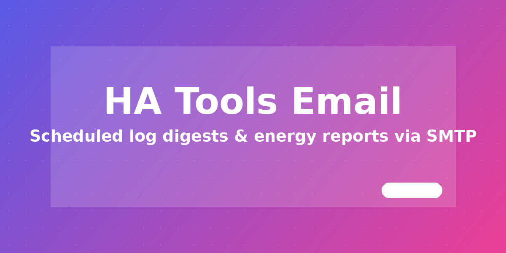
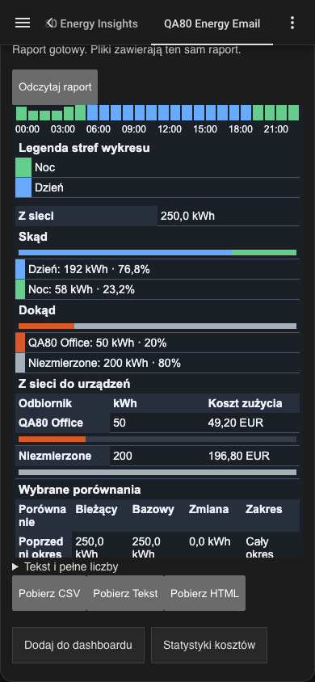
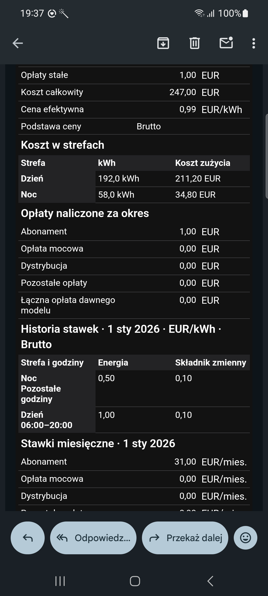

# HA Tools Email



Energy analysis, reports and optional email delivery for Home Assistant. Read energy reports inside HA without SMTP. Configure SMTP when you want to send mail or enable a mail schedule. Existing HA Tools service calls and server-side log digests remain supported.

[](https://www.home-assistant.io/) [](LICENSE) [](https://github.com/MacSiem/ha-tools-email-integration/releases)

Part of the [HA Tools](https://github.com/MacSiem) ecosystem.

## How it works

**Add the integration, then open your Energy card. To read a report, choose Preview → period/date → Read report. SMTP is optional.**

For email delivery, open **Settings → Devices & services → HA Tools Email → Configure**, save your SMTP settings, then use the card’s **Send Now** or explicitly save a **Schedule**. Opening a card or reading a report never enables a schedule or sends a message.

1. **Zero-input config flow.** Adding the integration creates a single config
   entry with no form fields.
2. **SMTP settings in the integration options.** Open **Settings → Devices &
   services → HA Tools Email → Configure** and enter server, port, encryption,
   username, password (or the name of a `secrets.yaml` key), sender and default
   recipients. You can send a test email before saving. Settings are kept with
   Home Assistant's Store helper; the password is never shown again and is never
   stored in the config entry options. Existing
   `<config>/ha-tools/smtp-config.json` settings are migrated automatically
   and the plaintext legacy file is removed only after Store saves
   successfully.
3. **Cards use the same SMTP integration.** Compatible Log and Energy cards
   can request server-composed reports through `send_now` and read the actual
   mail before sending. Existing `get_config`, `test` and `send` service calls
   remain supported for older cards and custom automations.
4. **Server-side scheduling is optional.** Since v2.0.0 you can also store
   schedules (`log_digest` or `energy_report`, daily/weekly/monthly) through
   the `ha_tools_email/set_schedule` websocket command. The integration then
   composes the report from Home Assistant's own `system_log` records or
   recorder statistics and sends it through the same SMTP path, without any
   card open in a browser.

### What is automatic vs. manual

| Automatic | Manual |
|---|---|
| Config entry creation (no fields to fill in) | Entering SMTP settings once in **Configure** |
| Report composition (log digest, energy report) once scheduled | Creating a schedule via the websocket API |
| Per-period duplicate-fire guard across normal callbacks and restarts | Sending an on-demand report (`send_now` / `send` service) |
| `!secret` resolution at send time | Adding secrets to `secrets.yaml` |

## Entities

The integration exposes services, a websocket API and the shared Energy device described below. Its five read-only entities provide current tariff zone, usage price, cheap-period status, next cheap start and today’s measured usage cost. They do not enable notifications.

Each configured Email schedule also has its own status sensors, a Send now button, attempt event and read-only calendar. The next-report time follows the saved calendar; manually sending does not consume an automatic schedule period. A disabled calendar can still be sent manually by an authorized user. The mail-server-accepted outcome does not confirm delivery. Error and warning counts stay unknown until a complete 24-hour source is available. Existing entity names and customizations are preserved.

Energy entities attach to the grid-import meter's device when that device is unambiguous; otherwise they use their own Energy device. Stable entity identifiers and personal names are retained when the source changes. Home Assistant Repairs can guide an administrator to configure a missing grid-import meter or investigate confirmed overlapping device measurements. Missing or partial readings do not count as a successful repair.

The active shared tariff book supplies these entities, including its currency, dated rate versions and explicit zone classification. A legacy profile is used only when no book is configured or an explicit compatible request selects it. An invalid book or missing active tariff leaves prices unavailable. **Cost today** contains measured energy and variable usage charges; it excludes monthly fixed fees. Its monetary total resets at the start of the measurement-calendar day. The current usage price is a separate currency/kWh measurement.

## Native cost statistics

Open a full Energy card as an administrator and choose **Cost statistics** in its footer. Review the exact sources, currency and gross/net basis, then explicitly enable sharing. The integration adds hourly usage costs from its existing server calculations. The feature is off by default; reading a card does not enable it. The dialog shows automatic-update status and gives an explicit seven-day backfill using current room assignments. Historical room membership is not reconstructed.

The updater waits for the configured meters to produce a complete hour, including readings that arrive late. It remembers the waiting hour across restarts. Missing measurements stay unavailable; they are never published as measured zero. If automatic updates pause, review the configured sources and permissions before enabling them again.

If a statistics import remains unconfirmed after a settings change, choose **Disable**, then **Read status**, review the new dataset and enable it explicitly. Disable stops future retries and keeps the old intent and history for reference. Work already queued in Recorder may still finish. A new consent after Disable creates separate series; it does not retry or confirm the old import. The dialog shows the count of unconfirmed historical imports.

Native Recorder statistics are readable by **all authenticated Home Assistant users**. Disabling sharing stops future writes; it does not remove or restrict previously published history or exported copies. Each source/currency dataset needs its own explicit consent. No notification or email is sent by this feature. Use the catalog's cost-series names in Home Assistant's Statistics graph card, with hourly changes and seven days. Keep currencies separate and avoid adding a household zone total to its room breakdown.


## Reading energy reports in Home Assistant

1. Configure your grid import and any measured devices in Home Assistant’s **Energy Dashboard**.
2. Add an Energy Optimizer, Energy Insights or Energy Email card. With the current schema-2 API, the cards share the server’s calendar periods, recorded measurements and tariff calculations.
3. In Energy Email, open **Preview**, select **Day / Week / Month / Year**, optionally choose a calendar date and comparison, then press **Read report**. Read it in HA or explicitly download HTML, text or CSV. No recipient or SMTP account is required.
4. If HA Energy already records grid-import costs, the analysis and report show **Cost recorded in HA** without a tariff book. An administrator can save a tariff under **Tariff settings** to calculate its energy charges, variable charges and fixed fees. Missing values remain unavailable; measured zero remains zero. Fixed tariff fees apply once to the household period.

Report access follows the administrator’s saved feature policy and native HA resource permissions. Existing defaults are retained until an administrator saves a policy; energy reports default to administrator access. A policy may allow a household user to read reports without granting permission to send mail, edit SMTP, change tariffs or manage schedules. The card hides unavailable actions; the server also checks every request.

With no tariff book, native recorded cost comes from the cost statistic linked in HA Energy or the cost sensor explicitly registered by Core. Its metadata must match HA’s currency, and a complete sum requires every configured import source-hour. Partial recorded amounts remain subsets. Cost breakdown, fixed fees and gross/net basis are unknown. Configured number/entity prices are shown as current observations and never reconstruct historical costs. A configured book keeps its own calculations; invalid or inactive books do not silently switch to native costs. The tariff-derived entities and opt-in cost-statistics publisher retain their existing meaning.

Native cost statistics and price entities require their own current read permission. A reader who can access energy but cannot access its cost or price receives only the allowed energy analysis. Revocation, changed bindings, unit/currency changes and unload invalidate pending or cached native facts.

The read-only `ha_tools_email/energy_report` endpoint returns HTML, text and CSV from the same prepared snapshot. Calendar comparisons use actual measured bounds, including daylight-saving changes. The browser supplies its display language, date language, timezone and 12/24-hour preference; this never changes the measurement calendar or tariff clock. Legacy preview/send endpoints described later retain their documented role and rolling-window behavior.

The report places a published comparison beside the energy total and an effective tariff price beside cost when available. Its zone legend and **From / To** composition bars use proven complete breakdowns; partial or overlapping data stays unavailable. HTML and plain text use localized, readable numbers throughout: one decimal for kWh, two for amounts and whole percentages. Rates retain up to four decimals when needed; tiny nonzero values use explicit bounds rather than looking like measured zero. The CSV export in HA retains the exact producer values and is not added as an email attachment. Repeated local hours at the daylight-saving transition include their numeric UTC offsets.



[Capture provenance](docs/screenshots/provenance.json). This is an HA preview with synthetic measurements; no email was sent.

The current complete report was also checked after real QA delivery in Gmail Light and Dark, in Polish and English. The lower cost, fee and rate tables keep short numbers and visible units:



This unedited Gmail capture uses synthetic measurements. [Capture details](docs/screenshots/provenance.json) distinguish client validation from the earlier HA preview.

## Services

| Service | Purpose |
|---|---|
| `ha_tools_email.send` | Send an email to one or many recipients with plain text and optional HTML. |
| `ha_tools_email.test` | Send a test message to the configured default recipient/sender to verify SMTP settings. |
| `ha_tools_email.save_config` | Admin-only: persist non-secret SMTP settings. Passwords are not accepted as action data; use **Configure** or `password_secret`. |
| `ha_tools_email.get_config` | Admin-only: return non-secret SMTP state. Password data and secret-key names are never included. |
| `ha_tools_email.list_secrets` | Admin-only: return available `secrets.yaml` key names only — secret values are never returned. |

```yaml
service: ha_tools_email.save_config
data:
  server: smtp.example.com
  port: 587
  username: user@example.com
  password_secret: smtp_app_password   # name of a secrets.yaml key; optional
  sender: user@example.com
  encryption: starttls
  default_recipient: recipient@example.com
```

```yaml
service: ha_tools_email.send
data:
  to: "user@example.com"
  subject: "HA Tools report"
  body: "Plain-text body."
  html: "<h2>Optional HTML body</h2>"
```

## Automation example

```yaml
alias: Email me when the freezer sensor goes offline
trigger:
  - platform: state
    entity_id: sensor.freezer_temperature
    to: "unavailable"
    for: "00:15:00"
action:
  - service: ha_tools_email.send
    data:
      subject: "⚠️ Freezer sensor offline"
      body: >
        sensor.freezer_temperature has been unavailable for 15 minutes.
        Check the device and the SMTP settings in Settings → Devices & services → HA Tools Email → Configure.
```

## Shared Energy snapshot and entities

From **2.4.0**, install/update the integration in HACS, then add **HA Tools Email** under **Settings → Devices & services**. Configure Energy Dashboard grid import and save a shared tariff from Energy Optimizer **4.0+ → Tariff settings**. Select an optional zone classification for cheap-zone and next-cheap values. Open the Energy device under this integration to use the seven entities. SMTP is not needed for these read-only energy values; notifications require a separate Home Assistant automation.

The integration exposes a shared Energy device with current tariff zone, current
usage price, cheap-period status, next cheap start and today's measured usage
cost, grid energy imported today and cheap-energy share today. All seven entities and `ha_tools_email/energy_snapshot` use the same tariff
engine and grid-import Recorder measurements. Entity identifiers remain stable
across reloads. PL/EN names are included.

The snapshot accepts an optional `profile` for a validated read-only card override;
omitting it reads the persisted shared tariff. Overrides never change global
entities or save settings. The response contains bounded current/next_cheap/today
sections and actual tariff currency, without meter identifiers, SMTP settings or
raw profiles. Active household users can read it; tariff writes remain admin-only.

Historical cards can batch their supplied intervals through
`ha_tools_email/energy_price_queries` with `{queries: [{buckets, coverage?}], profile?}`.
Results retain the order, completeness and rows of `EnergyTariff.price_buckets`.
These are calculations over card-supplied data, never new household measurements
and never input to the seven global entities. The endpoint performs no Recorder,
SMTP or settings writes. It permits up to 64 queries, 2048 buckets, 2048 total
measured hours, 512 KiB of input and a weighted tariff-work budget; complex
profiles may reach that work budget earlier. All calculations share one bounded
CPU lane with snapshots, including across reloads and cancellation.

Profiles may explicitly set `classification` to `cheap`, `expensive` or `mixed` on
zones and dynamic intervals. Missing classification stays unknown; prices and names
do not imply a cheap period. The primary current price includes energy and variable
fees. Unknown variable fees mean unknown usage price and cost. Fixed monthly fees
are metadata only, never prorated into today's charge. Today's window starts at
HA-local midnight and combines completed Recorder hours with actual completed
five-minute readings from the current hour. The values share the reported
`measurement_through` cutoff; missing intervals stay unavailable, and real zero
remains zero. Fractional-hour calendar boundaries remain unknown. A future cheap start is bounded to eight days
and skips the current continuous cheap segment.

The current-zone enum contains the configured zone ID (for example `day`),
with `classification` (`cheap`, `expensive`, `mixed` or unknown), label, rate and
next-change attributes. When upgrading an automation that compared the older
classification state, compare the `classification` attribute or the cheap-period
binary sensor instead. Entity unique IDs and user customizations stay stable.

## Energy data and previews

Energy reports measure the unique grid-import `stat_energy_from` sources configured
in Home Assistant's Energy Dashboard. Each grid source uses its nonempty flat
`stat_energy_from` when present, otherwise imports from `flow_from` are used.
Exports, solar sources and arbitrary discovered device meters are excluded.
Daily, weekly and monthly reports cover the last 24, 168 and 720 completed UTC hours;
the exact start and end are included in the report. Recorder metadata determines Wh/kWh/MWh
conversion to kWh (Wh × 0.001, kWh × 1, MWh × 1000). Missing hours or unsupported metadata withhold the period total; measured
zero stays zero. No tariff is assumed. With an explicitly saved shared tariff,
measured hourly energy is priced against its matching zones and rules. The
report states energy cost, variable per-kWh charges and monthly fixed fees
separately; the fixed fee is not silently prorated or added to an energy total.
Missing measurements, conflicting rules or missing rates remain unavailable.

From 2.3.1, a gap in one meter does not discard other measurements. The report
shows **Recorded usage** (the sum of retained valid readings), coverage in
source-hours, per-source measured hours and available charts. This subtotal is
not a complete household-period total. A combined hourly chart value requires
all configured sources for that hour; a missing interval stays a visible gap.
Source rankings remain available alongside the time profile. Full-period cost
and previous-period comparisons still require complete data.

Log reports use Home Assistant's bounded in-memory `system_log` buffer, which
can lose older entries on restart or eviction. An empty completed-period buffer
is labelled **history unavailable**, not zero errors. If newer retained entries
are available, the email includes a separate **Current diagnostics** section,
explicitly outside the requested report period. It does not invent a historical
archive or attribute those lifetime aggregate counts to the previous day.

Server schedules use the previous completed local day, ISO week or calendar
month in the schedule's timezone. On-demand `send_now` and the default preview
keep the existing rolling completed-hour periods described above. To preview a
completed calendar period without sending, request
`ha_tools_email/preview_energy_report` with `calendar_period: true` and an
optional IANA `timezone`. Returned bounds and coverage state the actual range.

HTML email contains self-contained static charts built from the same summary
and measured records as its tables; plain text includes the corresponding data.
No remote chart script or image is fetched. Missing values are labelled rather
than drawn as measured zero. Long daily series state their display limit; the
full report model is not replaced by the displayed subset.

Administrators can read `ha_tools_email/preview_energy_report` with `cadence` set to
`daily`, `weekly` or `monthly`. It returns the same summary model used by `send_now`
and schedules, without sending email or changing schedules. Energy Email cards need
a version supporting this endpoint to show the server preview.

## Actual mail preview and manual periods (2.3+)

With 2.4+, the server uses Home Assistant’s configured language (Polish or English) and time zone for human-readable mail dates. This presentation is separate from the schedule or requested calendar time zone: the same exact period bounds and measurements are retained. Repeated DST hours include their offset. Missing language/time-zone configuration falls back to English/UTC. Browser charts continue to follow the user’s display settings. Hourly mail chart labels and comparison bounds use the HA presentation time zone; calendar-day labels keep their measured report-calendar day and state that zone explicitly. Raw interval identities stay unchanged.

HTML mail includes light/dark surfaces without external assets. The final Log explanation keeps the complete retained-aggregate caveat; chart-specific omission and missing-value notes stay with each chart. Email clients may apply their own color treatment.

Choose **daily**, **weekly** or **monthly**, then choose the period:

| Period mode | Log digest | Energy report |
|---|---|---|
| `rolling` | Retained groups last observed in the last 24 hours, 7 days or 30 days | Last 24, 168 or 720 completed Recorder hours |
| `calendar` | Previous completed local day, ISO week or calendar month | Previous completed local day, ISO week or calendar month |

Calendar periods use the requested IANA timezone, otherwise Home Assistant's
configured timezone. Their lengths can differ across DST transitions and months.
The exact start is inclusive and the end exclusive. Log totals describe retained
aggregates, not exact event counts or complete historical coverage; a retained
group may include earlier occurrences. Missing timestamps are excluded from an
explicit manual window. Missing Energy measurements remain unavailable.

Use the administrator-only preview command for either kind:

```json
{
  "type": "ha_tools_email/preview_log_digest",
  "cadence": "monthly",
  "format": "mail",
  "period_mode": "calendar",
  "timezone": "Europe/Warsaw",
  "max_entries": 50
}
```

For Energy, use `ha_tools_email/preview_energy_report` and omit `max_entries`.
The response includes `subject`, `body`, `html`, `cadence`, `period`, `source`,
`generated_at` and the effective calendar timezone. It does not contact SMTP or
write settings, schedules, history or digest state. The existing summary-format
preview and Energy `calendar_period: true` alias remain available.

To send the same selected kind and period, call `ha_tools_email/send_now` with
`kind` (`log_digest` or `energy_report`), the same `cadence`, `period_mode` and
optional `timezone`, plus optional `recipients`. For Log, `max_entries` is an
integer from 1 to 1000, default 10, limiting each recent severity list rather than
its aggregate counts. Both preview and send compose from current server data;
new data between the two requests can change the report. Explicit manual sends
do not update the scheduled Log digest's seen keys or last-digest time.

Calendar Energy reports include comparison against the adjacent previous
calendar period when both periods have complete supported measurements. Actual
hours and dates remain visible; totals are not normalized to equal duration.
A zero comparison baseline has no percentage change. Rolling reports do not
claim a calendar comparison. Grid-import statistics do not establish individual
appliance consumption or a solar-flow diagram.

`accepted_by_smtp` means that the configured SMTP server accepted the attempt;
it does not confirm delivery to the recipient's inbox. Unconfirmed results do
not trigger an automatic resend. HTML and plain text retain full messages,
Polish characters and emoji; malformed unpaired surrogate characters become the
Unicode replacement character without changing stored log identity.

## Scheduled reports

Schedules are stored with Home Assistant's `Store` helper, not YAML, and are
managed through the websocket API below. Each schedule looks like:

```json
{
  "kind": "log_digest",
  "cadence": "daily",
  "time": "07:30",
  "recipients": ["user@example.com"],
  "enabled": true
}
```

- `kind`: `log_digest` or `energy_report`.
- `cadence`: `daily`, `weekly` or `monthly` at the chosen `time`.
- `timezone`: optional IANA zone; if absent, use Home Assistant's configured zone.
- `weekday`: weekly day, Monday 0 through Sunday 6; default Monday.
- `month_day`: monthly day 1–31; short months clamp to their last day; default 1.
- `use_ha_timezone: true` on an explicit edit clears a previous zone override.
- A spring DST gap moves forward by the offset change; the repeated autumn time
  fires only on its first occurrence. The same resolver computes `next_fire`.
- A confirmed period marker is stored before SMTP. If that save fails, no mail
  is sent. An uncertain transport result is not retried automatically, including
  after reload or restart.
- If `recipients` is empty, the scheduler falls back to `default_recipient` from the saved SMTP config.

Log digests read Home Assistant `system_log` records, aggregate counts by
level and logger, deduplicate against the previous digest, and include the
top 10 recent errors and warnings. Energy reports use only configured Energy Dashboard grid imports and read
Recorder `statistics_during_period` changes with Wh/kWh/MWh metadata. Complete
hourly coverage across every source is required for a full-period total. The
grid-source breakdown retains available measured readings with their coverage;
unrelated appliance counters are not added.

## Websocket API

Commands use the integration domain as the `type` prefix.

Read non-secret SMTP state and schedules (admin required):

```json
{ "type": "ha_tools_email/get_config" }
```

List schedules (admin required):

```json
{ "type": "ha_tools_email/list_schedules" }
```

Create or update a schedule (admin required):

```json
{
  "type": "ha_tools_email/set_schedule",
  "action": "upsert",
  "schedule": {
    "kind": "energy_report",
    "cadence": "weekly",
    "time": "08:00",
    "recipients": ["user@example.com"],
    "enabled": true
  }
}
```

Delete a schedule (admin required):

```json
{
  "type": "ha_tools_email/set_schedule",
  "action": "delete",
  "schedule_id": "schedule-id"
}
```

Compose and send a report immediately (admin required):

```json
{
  "type": "ha_tools_email/send_now",
  "kind": "log_digest",
  "cadence": "daily",
  "recipients": ["user@example.com"]
}
```

SMTP configuration, schedules, previews, sending and attempt history require
an administrator connection. The legacy services
that save/read SMTP settings or list secret-key names are admin-only too.

## Shared tariffs

`ha_tools_email/get_tariff` returns only `profile`, `revision` and `updated_at`
for an authenticated household connection. It does not read SMTP settings,
migrate legacy files, send mail or change the saved profile. Administrator-only
`ha_tools_email/set_tariff` accepts a validated `profile` (or `null` to clear it)
and `expected_revision`; conflicts require an explicit reload rather than retry.
A successful save requires a completed underlying HA Store write.

Custom profiles support currency, IANA civil time or an explicit fixed meter
clock, zone energy and variable rates, separate monthly fees, weekday/season
rules and date exceptions. Zero rates are valid. Measurements spanning a rate
boundary are not arbitrarily split or priced from an average. Configure prices
explicitly; no national tariff, holiday calendar or current market price is
installed automatically. Compatible Smart Reports and Energy cards use this
shared service; basic Recorder reports do not require SMTP configuration.

## Dispatch attempt history

Administrator-only `ha_tools_email/get_attempt_history` returns at most 128
logical attempts retained for 90 days. Manual services, on-demand reports,
schedules and options tests use one dispatcher and the same history. Metadata
contains an attempt ID, time, controlled kind/source/cadence/period, a hashed
schedule reference, recipient count and controlled outcome. It excludes mail
addresses, subjects, bodies, credentials and raw exception text.

`accepted_by_smtp` means the SMTP server accepted the message, not that it was
delivered. Transport interruption or cancellation can have an unknown outcome;
there is no automatic resend. A failed history write is reported separately as
`history_status: unavailable`. For log digests, failure of the post-send dedup
metadata is separately `digest_state_status: unavailable` and does not turn an
accepted message into `send_failed`. Check the previous attempt before deciding
to send again. SMTP and Store are separate systems: a process crash between
acceptance and the history write may leave no history record.

Schedules and history publish new in-memory state only after confirmed storage.
Failed legacy SMTP migration leaves its file in place; a failed options save
keeps the form open. If an options test was already accepted, the form states
that separately and does not select the test again automatically.

## Installation

### HACS default catalog

HA Tools Email is included in the HACS default catalog as an Integration.
Download it in HACS, restart Home Assistant, then add **HA Tools Email** under
**Settings → Devices & services → Add integration**. Configure SMTP in its
options only when sending is needed. Existing config entries and Store data
are retained on upgrade; do not delete them to update the integration.

### HACS Custom Repository

1. Open HACS.
2. Open **Custom repositories**.
3. Add `https://github.com/MacSiem/ha-tools-email-integration` with category **Integration**.
4. Install **HA Tools Email**.
5. Restart Home Assistant.
6. Go to **Settings → Devices & services → Add integration** and add **HA Tools Email**. The setup form has no fields — just confirm.
7. Open **Configure** on the HA Tools Email integration and enter your SMTP settings. Optionally enable **Send a test email before saving**. SMTP acceptance confirms handoff to the server; check the inbox or provider separately for delivery.

### Manual

1. Copy `custom_components/ha_tools_email/` to `<config>/custom_components/`.
2. Restart Home Assistant.
3. Add **HA Tools Email** from **Settings → Devices & services**.
4. Enter SMTP settings as in step 7 above.

## FAQ

**Where does my email go?**
Only to the SMTP server you configure in the integration options. The
integration does not relay through any third-party or Home Assistant Cloud
service.

**Is my SMTP password exposed to the frontend or other users?**
No, and the two read paths are deliberately different:

- The admin-only `ha_tools_email/get_config` **websocket** command returns a
  `_safe_smtp_config` payload with only `server`, `port`, `username`,
  `sender`, `encryption`, `default_recipient`, `uses_secret` and
  `smtp_configured` — there is no `password` key in the response at all.
- The admin-only `ha_tools_email.get_config` **service** returns the same
  non-secret SMTP state. It never returns a password, password fragment,
  `!secret` reference, or list of available secret-key names.

**Can any logged-in user read or change my SMTP settings?**
No. Since 2.1.0 reading non-secret config and schedules through the websocket
API (`get_config`, `list_schedules`) requires an administrator. Creating, editing or
deleting a schedule (`set_schedule`) and triggering an on-demand send
(`send_now`) require an admin-level websocket connection. The legacy
`save_config`, `get_config`, and `list_secrets` services also require an
administrator. Sending mail through `ha_tools_email.send` and testing the
household SMTP account also require an administrator for interactive calls.
Home Assistant automations without a user context continue to work.

**Does a successful send mean delivery to the inbox?**
No. `accepted_by_smtp` means the configured SMTP server accepted the message.
Final delivery and any later bounce must be checked at the SMTP provider.
The schedule period marker is confirmed before SMTP, preventing a second
callback after reload or restart from sending that period again. A crash after
the marker but before SMTP can leave that period unsent; a crash after SMTP but
before history persistence can leave no attempt record. Check the previous
attempt before a manual resend; neither case triggers automatic retry.

<a id="smtp-password-security"></a>
**Why can't I pass the password to `save_config` any more?**
Home Assistant records the data of every action call in its database. A
password passed to `ha_tools_email.save_config` before 2.1.0 was therefore
also kept in the recorder database and in backups that include it. Since
2.1.0 the password is entered only in **Configure**, and the action rejects a
`password` field. If you saved a password through the action before, Home
Assistant shows a repair notice: create a new app password with your email
provider, enter it in **Configure**, and revoke the old one.

**Do I need a `notify:` platform configured?**
No. The integration talks to your SMTP server directly with `smtplib`.

**What happens if `secrets.yaml` doesn't have the key I referenced?**
The send fails with an explicit error identifying the missing key — nothing
is sent silently.

**Which cards use this integration?**
`ha-log-email` and `ha-energy-email` from their HA Tools frontend packages call
the services described above. Existing automations using
`ha_tools_email.send` continue to work; interactive calls from a
logged-in user require administrator access.

## Changelog

See [CHANGELOG.md](CHANGELOG.md).

## Support

If this tool makes your Home Assistant life easier, consider supporting development:

- [Buy Me a Coffee](https://buymeacoffee.com/macsiem)
- [PayPal](https://www.paypal.com/donate/?hosted_button_id=Y967H4PLRBN8W)

## License

MIT - see [LICENSE](LICENSE).

## Privacy and data

SMTP settings, recipients and reports are processed on your Home Assistant server. Sending a message transmits its content to the configured SMTP provider and recipients. Review those destinations and report content before enabling a schedule. Do not share passwords, addresses or raw configuration in public issues.

See [SECURITY.md](SECURITY.md) for safe vulnerability reporting and [NOTICE](NOTICE) for licensing notices.
